# TKYS - Güncel Veritabanı ER Diyagramı

Bu diyagram, `D04_Data_Dictionary.md` belgesinde tanımlanan 29 uygulama tablosunu esas alır.

```mermaid
erDiagram
    bolumler {
        int bolum_id PK
        string bolum_adi UK
        string sorumlu_ad_soyad
        string iletisim_bilgisi
        boolean aktif_mi
    }

    cihazlar {
        int cihaz_id PK
        string envanter_kodu UK
        string cihaz_adi
        string marka_model
        string seri_no UK
        string durum
        timestamp kayit_tarihi
    }

    cihaz_rezervasyonlari {
        int rezervasyon_id PK
        int cihaz_id FK
        int bolum_id FK
        int rezervasyonu_yapan_personel_id FK
        timestamp baslangic_zamani
        timestamp bitis_zamani
        boolean iptal_edildi_mi
        int kullanilacak_oda_id FK
        string proje_turu
        string proje_adi_aciklamasi
        timestamp rezervasyon_tarihi
    }

    cihaz_arizalari {
        int ariza_id PK
        int cihaz_id FK
        string bildiren_personel
        text ariza_aciklamasi
        timestamp bildirim_tarihi
        timestamp cozum_tarihi
        boolean cozuldu_mu
    }

    cihaz_bakimlari {
        int bakim_id PK
        int cihaz_id FK
        string bakim_yapan_kisi
        text yapilan_islem
        decimal maliyet
        timestamp bakim_tarihi
        date sonraki_bakim_tarihi
        date bakim_baslangic_tarihi
        date bakim_bitis_tarihi
        int uyari_suresi_gun
    }

    cihaz_kalibrasyonlari {
        int kalibrasyon_id PK
        int cihaz_id FK
        string kalibrasyon_yapan_kurum
        date gecerlilik_tarihi
        string sertifika_no
        timestamp islem_tarihi
        date kalibrasyon_baslangic_tarihi
        date kalibrasyon_bitis_tarihi
        int uyari_suresi_gun
    }

    cihaz_bakim_planlari {
        int plan_id PK
        int cihaz_id FK
        string gorev_turu
        int periyot_gun
        int uyari_suresi_gun
        date sonraki_gorev_tarihi
        boolean aktif_mi
    }

    danisan_kodlari {
        string danisan_kod_id PK
        boolean ucretli_mi
        string istisna_turu
        boolean aktif_mi
        timestamp olusturulma_tarihi
        int olusturan_psikolog_id FK
        string yas_grubu
        boolean psikolog_pasifligi_nedeniyle_pasif
    }

    proje_turleri {
        int proje_turu_id PK
        string ad UK
        boolean aktif_mi
    }

    odalar {
        int oda_id PK
        string oda_adi UK
        int kapasite
        boolean aktif_mi
    }

    randevular {
        int randevu_id PK
        string danisan_kod_id FK
        int psikolog_id FK
        int oda_id FK
        timestamp baslangic_zamani
        timestamp bitis_zamani
        string durum
        timestamp olusturulma_tarihi
        string iptal_nedeni
        string iptal_notu
        string gorusme_tipi
        string terapi_turu
    }

    oda_etkinlikleri {
        int etkinlik_id PK
        int oda_id FK
        int organize_eden_personel_id FK
        string etkinlik_adi
        int katilimci_sayisi
        timestamp baslangic_zamani
        timestamp bitis_zamani
        boolean iptal_edildi_mi
    }

    psikolog_odalar {
        int kullanici_id PK, FK
        int oda_id PK, FK
    }

    roller {
        int rol_id PK
        string rol_adi UK
        string gorunen_ad
        boolean aktif_mi
    }

    izinler {
        int izin_id PK
        string izin_adi UK
        string aciklama
        string gorunen_ad
    }

    rol_izinleri {
        int rol_id PK, FK
        int izin_id PK, FK
        smallint izin_var
    }

    kullanicilar {
        int kullanici_id PK
        string kullanici_adi UK
        string parola_hash
        int rol_id FK
        boolean aktif_mi
        timestamp olusturulma_tarihi
        int basarisiz_giris_sayisi
        timestamp kilit_bitis_zamani
        boolean ilk_giris_mi
        timestamp gecici_parola_bitis
    }

    personel {
        int personel_id PK
        int kullanici_id FK, UK
        string personel_kodu UK
        boolean aktif_mi
        timestamp olusturulma_tarihi
        int varsayilan_oda_id FK
    }

    giris_istek_limitleri {
        string anahtar PK
        timestamp pencere_baslangici
        int istek_sayisi
    }

    parola_sifirlama_talepleri {
        int talep_id PK
        int kullanici_id FK
        timestamp talep_zamani
        string durum
        timestamp kapanis_zamani
        int kapatan_kullanici_id FK
    }

    ogrenciler {
        int ogrenci_id PK
        int kullanici_id FK, UK
        string ad_soyad
        string ogrenci_numarasi UK
        string telefon
        string tur
        boolean aktif_mi
        timestamp olusturulma_tarihi
    }

    danisma_masasi_oturumlari {
        int oturum_id PK
        int ogrenci_id FK
        timestamp baslangic_zamani
        timestamp bitis_zamani
        boolean onaylandi_mi
    }

    faaliyet_birimleri {
        int birim_id PK
        string birim_adi UK
        boolean aktif_mi
    }

    faaliyetler {
        int faaliyet_id PK
        string faaliyet_adi UK
        int puan
        boolean aktif_mi
    }

    ogrenci_faaliyet_takip {
        int takip_id PK
        int ogrenci_id FK
        int faaliyet_id FK
        int adet
        int birim_id FK
        date faaliyet_tarihi
        string aciklama
        boolean onaylandi_mi
        timestamp olusturulma_tarihi
        int kayit_puani
    }

    ogrenci_kayit_erteleme_gecmisi {
        int erteleme_id PK
        int ogrenci_id FK
        string ogrenci_numarasi
        date yeni_uyari_tarihi
        int erteleyen_kullanici_id FK
        timestamp olusturulma_tarihi
    }

    denetim_kayitlari {
        bigint denetim_id PK
        int kullanici_id FK
        string olay_turu
        string hedef_tablo
        int hedef_kayit_id
        timestamp olusturulma_tarihi
    }

    %% Veritabanında tanımlı FK ilişkileri
    cihazlar ||--o{ cihaz_rezervasyonlari : "cihaz_id"
    bolumler o|--o{ cihaz_rezervasyonlari : "bolum_id"
    personel o|--o{ cihaz_rezervasyonlari : "rezervasyonu_yapan_personel_id"
    odalar o|--o{ cihaz_rezervasyonlari : "kullanilacak_oda_id"
    cihazlar o|--o{ cihaz_arizalari : "cihaz_id"
    cihazlar o|--o{ cihaz_bakimlari : "cihaz_id"
    cihazlar o|--o{ cihaz_kalibrasyonlari : "cihaz_id"
    cihazlar o|--o{ cihaz_bakim_planlari : "cihaz_id"
    personel o|--o{ danisan_kodlari : "olusturan_psikolog_id"
    danisan_kodlari ||--o{ randevular : "danisan_kod_id"
    personel ||--o{ randevular : "psikolog_id"
    odalar ||--o{ randevular : "oda_id"
    odalar ||--o{ oda_etkinlikleri : "oda_id"
    personel ||--o{ oda_etkinlikleri : "organize_eden_personel_id"
    kullanicilar ||--o{ psikolog_odalar : "kullanici_id"
    odalar ||--o{ psikolog_odalar : "oda_id"
    roller ||--o{ rol_izinleri : "rol_id"
    izinler ||--o{ rol_izinleri : "izin_id"
    roller ||--o{ kullanicilar : "rol_id"
    kullanicilar ||--o| personel : "kullanici_id"
    odalar o|--o{ personel : "varsayilan_oda_id"
    kullanicilar ||--o{ parola_sifirlama_talepleri : "kullanici_id"
    kullanicilar o|--o{ parola_sifirlama_talepleri : "kapatan_kullanici_id"
    kullanicilar o|--o| ogrenciler : "kullanici_id"
    ogrenciler ||--o{ danisma_masasi_oturumlari : "ogrenci_id"
    ogrenciler ||--o{ ogrenci_faaliyet_takip : "ogrenci_id"
    faaliyetler ||--o{ ogrenci_faaliyet_takip : "faaliyet_id"
    faaliyet_birimleri ||--o{ ogrenci_faaliyet_takip : "birim_id"
    ogrenciler o|--o{ ogrenci_kayit_erteleme_gecmisi : "ogrenci_id"
    kullanicilar o|--o{ ogrenci_kayit_erteleme_gecmisi : "erteleyen_kullanici_id"
    kullanicilar o|--o{ denetim_kayitlari : "kullanici_id"
```

## Diyagram notları

- Diyagramda 29 uygulama tablosu bulunmaktadır.
- `alembic_version` teknik migration tablosudur; uygulama ER diyagramına dahil edilmemiştir.
- PK, FK ve UK işaretleri D04'teki veritabanı kısıtlarına dayanır.
- İlişki çizgileri FK bağlantılarını gösterir. Kesin zorunluluk, NULL ve UNIQUE kuralları için D04 Veri Sözlüğü esas alınmalıdır.
- `ogrenciler.tur` (`ogrenci_turu`) ve `denetim_kayitlari.olay_turu` (`denetim_olay_turu`) PostgreSQL ENUM sütunlarıdır. `cihazlar.durum` canlı veritabanında VARCHAR, test veritabanında `cihaz_durumu` ENUM tipindedir; bu şema uyumsuzluğu ayrıca giderilmelidir.

## Rezervasyon ve randevu çakışma kısıtları

- `cihaz_rezervasyon_cakisma`: İptal edilmemiş aynı cihaz rezervasyonlarının zaman çakışmasını engeller.
- `oda_randevu_cakisma`: PLANLANDI durumundaki aynı oda randevularının zaman çakışmasını engeller.
- `psikolog_randevu_cakisma`: PLANLANDI durumundaki aynı psikoloğun randevularının zaman çakışmasını engeller.

CHECK, DEFAULT ve NULL ayrıntıları için `D04_Data_Dictionary.md` belgesine bakılmalıdır.
